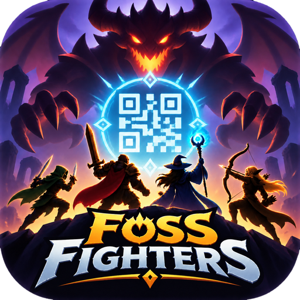

# FossFightersQR

A 2D Godot 4.7 game in portrait mode that continuously scans the device camera for QR codes. See
[docs/qr_scanning.md](docs/qr_scanning.md) for how scanning works, building and testing.
Scanned codes are looked up in the card database, see [docs/cards.md](docs/cards.md).
The game starts with choosing the party, see [docs/onboarding.md](docs/onboarding.md). Design decisions and
hints for development are in [docs/game_design.md](docs/game_design.md).
