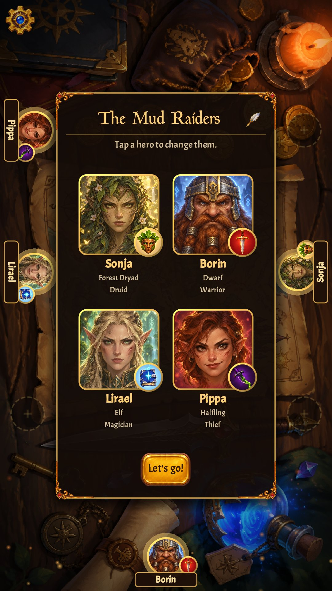
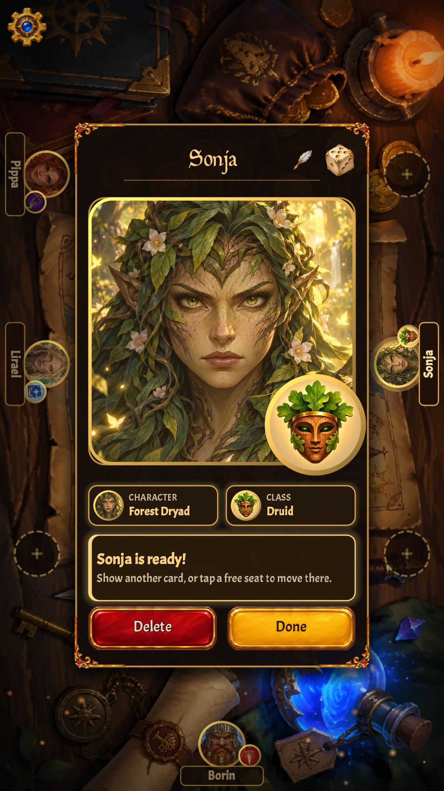
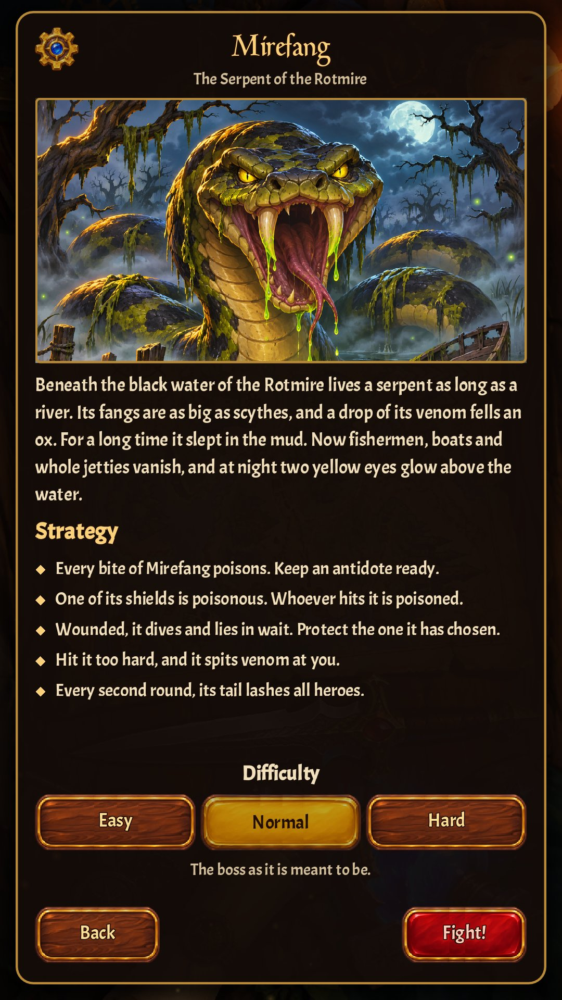
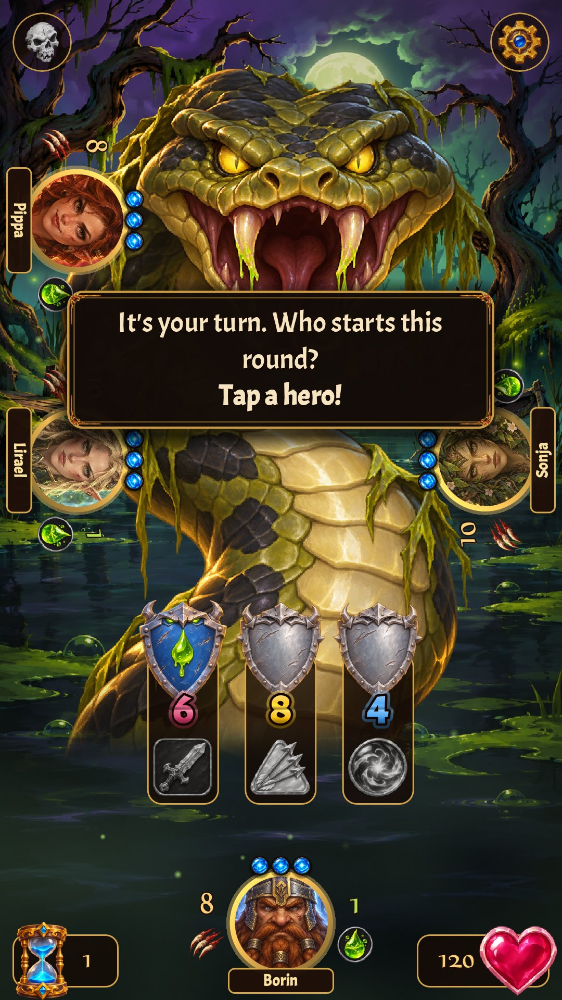
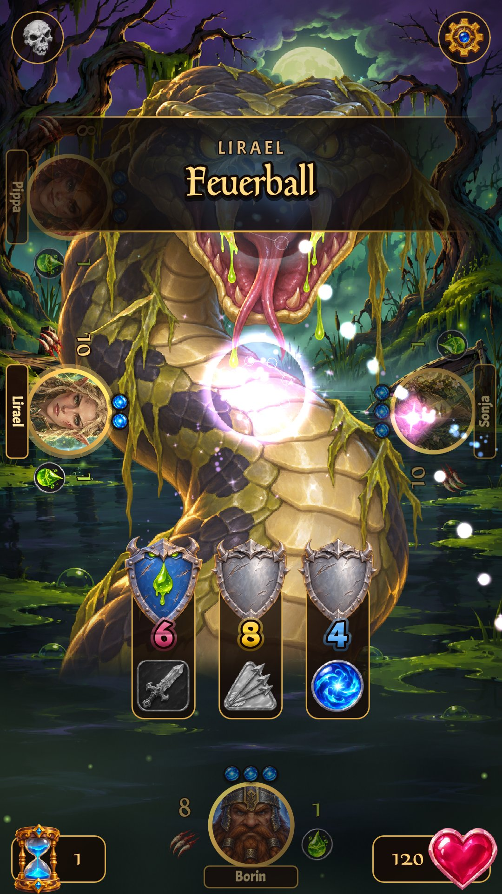
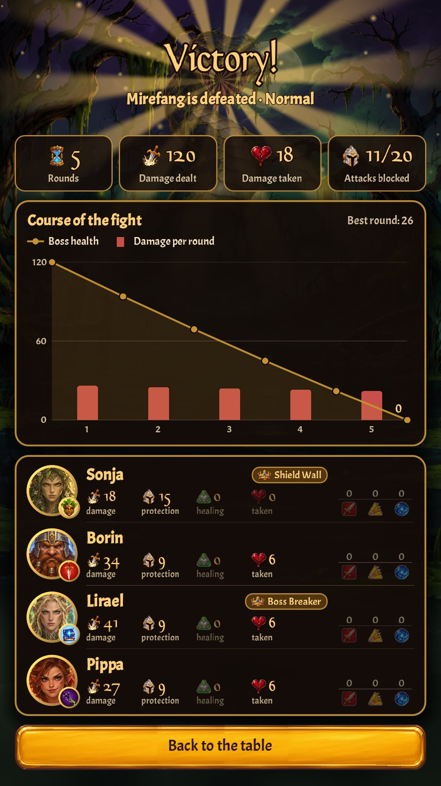

# ⚔️ Foss Fighters ⚔️

### The free, open source companion app for **Boss Fighters QR**

*Scan your cards. Face the boss. Fight together.*

---

## 💌 A love letter to Boss Fighters QR

**Boss Fighters QR** is a cooperative card game by Pegasus Spiele where you and your friends
team up against powerful bosses. Your phone becomes the boss: you scan your cards, and it
strikes back.

We love this game so much that we built a companion app for it. **Foss Fighters QR** is a fan
project made by players for players.

> [!IMPORTANT]
> **You need the physical game to play.** If you don't own it yet, please buy it and support
> the people who made it:
>
> ### 👉 [Get Boss Fighters QR from Pegasus Spiele](https://pegasusna.com/News/Boss-Fighters-QR/) 👈

---

## 📸 A look inside

<table>
<tr>
<td width="33%" align="center" valign="top">

 <b>Gather your party</b>
 Everyone takes their seat around the table.
</td>
<td width="33%" align="center" valign="top">

 <b>Scan your hero</b>
 Show your character and class cards, and pick a name.
</td>
<td width="33%" align="center" valign="top">

 <b>Choose your foe</b>
 Meet Mirefang, the Serpent of the Rotmire.
</td>
</tr>
<tr>
<td width="33%" align="center" valign="top">

 <b>Know your enemy</b>
 See the boss's attacks and shields, then plan your round.
</td>
<td width="33%" align="center" valign="top">

 <b>Strike back</b>
 Every card you play hits the boss with a big effect.
</td>
<td width="33%" align="center" valign="top">

 <b>Celebrate together</b>
 See how the fight went, and who earned which title.
</td>
</tr>
</table>

---

## ✨ Why Foss Fighters?

<table>
<tr>
<td width="50%" valign="top">

### 🐉 More bosses
The base game is only the beginning. We're adding **lots of new bosses** so your table always
has a fresh challenge.

</td>
<td width="50%" valign="top">

### 💸 Free forever
**No ads. No subscription. No in-app purchases.** Download it and play. It stays free.

</td>
</tr>
<tr>
<td width="50%" valign="top">

### ⚡ Lightning-fast scanning
Very good QR code detection. Cards are recognized **fast and reliably**, so you spend less time waving cards at your phone and more time fighting.

</td>
<td width="50%" valign="top">

### 🔋 Easy on your battery
Optimized for **low battery usage**, so the boss runs out of health before your
phone runs out of power.

</td>
</tr>
<tr>
<td width="50%" valign="top">

### 🎨 Looks great
**Beautiful graphics and smooth animations** that set the mood for every fight.

</td>
<td width="50%" valign="top">

### 🔓 Open source
Anyone can see how the app works, suggest improvements, or help out. Nothing hidden.

</td>
</tr>
</table>

---

## 🎲 How it works

1. **Pick your party.** Choose your heroes at the start of the game.
2. **Play your cards.** Hold each card you play in front of the camera.
3. **Face the boss.** The app reacts to every move and fights back.
4. **Win together** (or try again, the boss is waiting 😈).

---

## 🙌 Get involved

Found a bug or have an idea for a new boss? [Open an issue](https://github.com/BorisBrock/FossFightersQR/issues)
and tell us about it. Every bit of feedback helps.

---

<b>🛠️ For developers</b>

 

Foss Fighters QR is a 2D Godot 4.7 game in portrait mode. Documentation:

- [QR scanning](docs/qr_scanning.md): how scanning works, building and testing
- [Card database](docs/cards.md): how scanned codes become cards
- [Onboarding](docs/onboarding.md): choosing the party
- [Choosing the boss](docs/bosses.md): the boss list and overview, and how bosses are defined
- [The boss fight](docs/boss_fight.md): the game screen
- [Game over](docs/game_over.md): the outcome and the statistics of a fight
- [Game design](docs/game_design.md): design decisions and development hints
- [Settings](docs/settings.md)
- [Sounds](docs/sounds.md): which event plays which sound, and how the sound effects are made

## License

Copyright (c) 2026 Boris Brock. Licensed under the [PolyForm Strict License 1.0.0](LICENSE.md).

You may download, build, and run the game for personal, noncommercial use.
You may **not** sell it, redistribute it (including publishing it in an app store), or publish modified versions or copies of the source under a different name.

Third-party assets keep their own licenses (see the `License.txt` files next to them).

Foss Fighters QR is an unofficial fan project and is not affiliated with or endorsed by
Pegasus Spiele. Boss Fighters QR is a trademark of its respective owners.

  

**Made with ❤️ by fans, for fans.**

